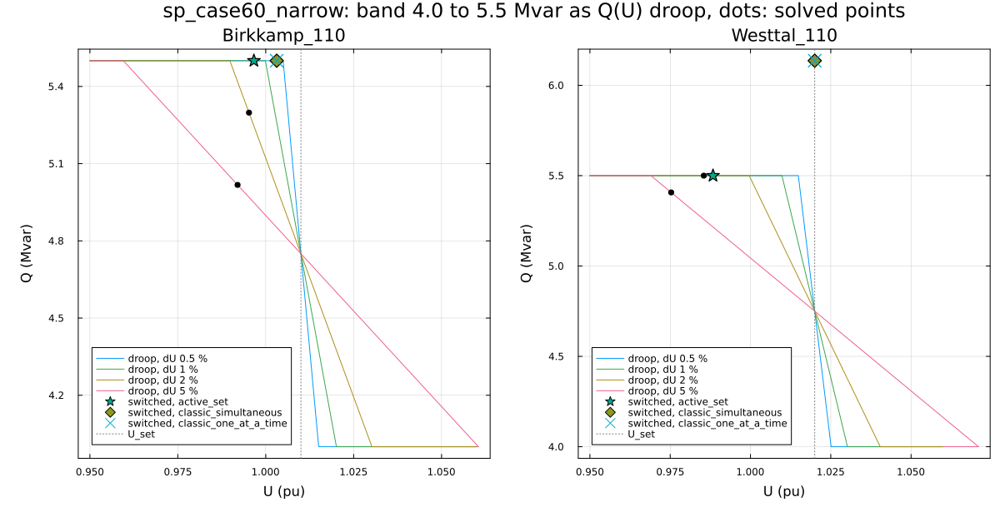

# PV/PQ switching strategies in Sparlectra: same network, different solutions

Three Q-limit strategies of [Sparlectra.jl](https://github.com/Welthulk/Sparlectra.jl)
0.60.0 (`active_set`, `classic_simultaneous`, `classic_one_at_a_time`) on the
same networks with the same start and tolerance. The strategy decides the
final solution (Zhao et al. 2008 [1], Zeng et al. 2023 [2]). This repository
is the recomputable version in Julia, with a check whether each converged
solution is an admissible operating point, and a Q(U) droop variant (Q(U)
instead of switching).

Details of every run, check and file: [docs/details.md](docs/details.md).

## Reproduce

```
git clone https://github.com/Welthulk/pvpq-study.git
cd pvpq-study
julia --project=. -e "using Pkg; Pkg.instantiate()"
julia reproduce.jl
```

Julia 1.13.2 (juliaup). Sparlectra comes from GitHub at commit a3cd5bc9
(`[sources]` in `Project.toml`), nothing has to be registered. A run
reproduces the committed files byte for byte (`git status --short results/`
shows nothing). Installation steps for Linux, macOS and Windows:
[docs/install.md](docs/install.md).

Settings: rectangular Newton-Raphson, 1e-6 pu, at most 80 iterations,
classic start, every automatic aid off, outer control loop off.

## 1. One network, three solutions

case14_zeng (the case of Zeng and Chiang as shipped with Sparlectra):

| Strategy | Iterations | Buses PV to PQ | Slack Q Mvar | Losses MW | Admissible |
|---|---|---|---|---|---|
| active_set | 7 | 3 | 22.47 | 21.945 | yes |
| classic_simultaneous | 9 | 4 | 18.42 | 21.506 | no, 3 buses |
| classic_one_at_a_time | 11 | 2 | 22.26 | 21.939 | no, 1 bus |


All three runs converge below 1e-6 pu; the solutions differ by up to 0.0118
pu in voltage and 0.44 MW in losses (`pairs.csv`). Only the active set
solution is an admissible operating point: `classic_simultaneous` ends with
buses 2, 3 and 6 at their upper Q limit while the voltage lies above the set
point (the "abnormal solution" of [1], eq. 7); `classic_one_at_a_time`
leaves bus 6 as PV with 24.68 Mvar against a limit of 24 Mvar.

In sp_case14 and sp_case118 the three strategies reach the same solution
(sp_case118: 5, 8 and 35 iterations, 10 buses switched).

## 2. Machines with a narrow reactive band

sp_case60_narrow: two 40 MW machines (Birkkamp_110, Westtal_110) get a band
of 4.0 to 5.5 Mvar, 0.015 pu. Both would need more than the band at their
set point (7.26 and 5.71 Mvar).



The active set ends with both machines at 5.5 Mvar below their set points
(admissible, but with the smallest eigenvalue of the reduced Jacobian at
0.007 close to voltage instability). The two classic strategies end on one
other solution: Westtal_110 holds 1.02 pu with 6.14 Mvar, 0.64 Mvar above
its limit. Voltages differ by up to 0.033 pu between the two solutions. The
narrow band guard (`power_flow.qlimits.guard`, on or off) changes no result.
The classic strategies accept this overshoot because it is below their Q
hysteresis of 0.01 pu; with the hysteresis set to 0 on the net (the config
key `hysteresis_pu` alone changes nothing here) `classic_simultaneous` ends
on the active set solution, as does `classic_one_at_a_time` in case14_zeng.

## 3. Q(U) droop instead of switching

The voltage regulator of chosen generators is replaced by a linear Q(U)
droop: Q_max at U_set - dU, Q_min at U_set + dU, clamped outside, dU 0.5 to
5 % of U_set. The Q(U) buses do not switch type; where every PV generator
gets the droop, the strategy has nothing to act on.


- The steeper the droop, the closer the solution to the switched solution
  that fulfils eq. 5 to 7 of [1]: in case14_zeng, sp_case60_narrow and
  sp_case60 with band `qbase_m1` this is the active set solution. In
  sp_case60_narrow the Q(U) points lie on the characteristic (figure in
  section 2); the classic solution with 6.14 Mvar has no such point.
- Which solution Q(U) reaches depends on the start. From the former set
  points case14_zeng ends on the high-voltage solution; from 1.0 pu on an
  unstable low-voltage one (0.59 to 0.72 pu, dU/dQ negative at three of the
  four machines). Converged is not stable, which is the objection of [1]
  against smooth characteristics.
- The band that fails with switching (-1.0 to 0.5 Mvar) fails with Q(U) as
  well. sp_case118 with Q(U) at all 53 PV generators converges only damped
  (49 iterations).
- P(U) as a second stage is not active at any converged solution and only
  changes the Newton path: case14_zeng ends damped on the Q(U) solution,
  sp_case60 on an unstable branch.

## Admissibility check

Every solution is checked at each regulated bus (`admissibility.jl`,
`consistency.csv`): at Q_max the voltage must be at or below the set point,
at Q_min at or above it (eq. 6, 7 of [1]); a PV bus must have Q inside its
limits (eq. 5); at a bus at a limit dU/dQ from a 0.1 Mvar perturbation with
bus types held must be positive. Tolerances 1e-3 Mvar and 1e-6 pu. The sign
of dU/dQ passes at every switched solution, including the abnormal ones;
only the voltage-side test finds them.

## Limits

- One Sparlectra commit, one start per switched run, one tolerance.
- Tap changers, phase shifters and the SVC stay at the case positions.
- Q(U) droop: one linear characteristic, not the smooth curve of [4];
  sp_case118 only at dU 1 %.
- No continuation power flow; [1] uses it as the independent check.

## References

1. Zhao, Chiang, Li, Ju: On PV-PQ bus type switching logic in power flow
   computation. 16th PSCC, Glasgow, 2008.
2. Zeng, Chiang, Neves, Alberto: On the accuracy of power flow and load
   margin calculation caused by incorrect logical PV/PQ switching. IJEPES
   147 (2023) 108905.
3. Sundaresh, Rao: Sadhana 2015.
4. Kataoka: A smooth power flow model of electric power system with
   generator reactive power limits taken into consideration. ISCAS 2005.
