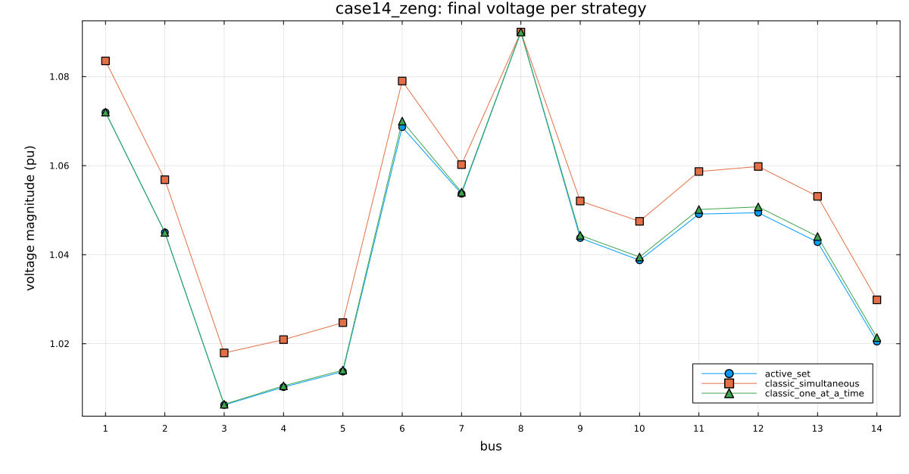
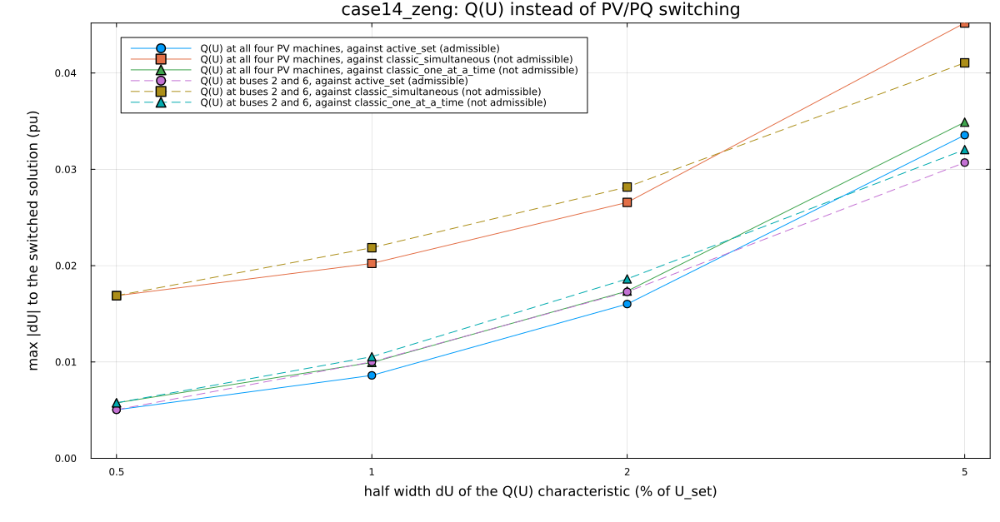
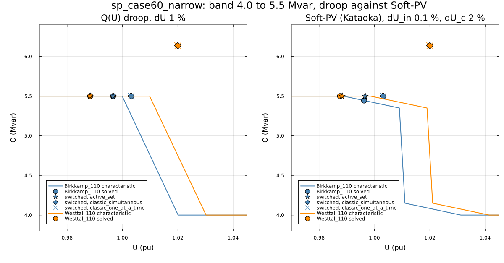

# PV/PQ switching strategies in Sparlectra: same network, different solutions

Three Q-limit strategies of [Sparlectra.jl](https://github.com/Welthulk/Sparlectra.jl)
0.60.0 (`active_set`, `classic_simultaneous`, `classic_one_at_a_time`), same
networks, start and tolerance. The strategy decides which solution the
power flow ends on (Zhao et al. [1], Zeng et al. [2]). Every converged
solution is checked for whether it is an admissible operating point.
Details of every run, check and file: [docs/details.md](docs/details.md).

## Reproduce

```
git clone https://github.com/Welthulk/pvpq-study.git
cd pvpq-study
julia --project=. -e "using Pkg; Pkg.instantiate()"
julia reproduce.jl
```

Julia 1.13.2, Sparlectra from GitHub at commit a3cd5bc9, installation in
[docs/install.md](docs/install.md). Two runs give byte-identical CSV files.
Rectangular Newton-Raphson, 1e-6 pu, at most 80 iterations per Newton
solve, classic start, all automatic aids and the outer control loop off.

## 1. One network, three solutions

case14_zeng (the case of Zeng and Chiang as shipped with Sparlectra):

| Strategy | Iterations | Buses PV to PQ | Slack Q Mvar | Losses MW | Admissible |
|---|---|---|---|---|---|
| active_set | 7 | 3 | 22.47 | 21.945 | yes |
| classic_simultaneous | 9 | 4 | 18.42 | 21.506 | no, 3 buses |
| classic_one_at_a_time | 11 | 2 | 22.26 | 21.939 | no, 1 bus |



All three converge, the voltages differ by up to 0.0118 pu, only the active
set solution is admissible. `classic_simultaneous` leaves buses 2, 3 and 6
at Q_max with the voltage above the set point (eq. 7 of [1]),
`classic_one_at_a_time` leaves bus 6 PV with 24.68 Mvar against 24 Mvar.
In sp_case14 and sp_case118 all strategies reach the same solution.

## 2. Machines with a narrow reactive band

sp_case60_narrow: two 40 MW machines (Birkkamp_110, Westtal_110) get a band
of 4.0 to 5.5 Mvar but would need 7.26 and 5.71 Mvar at their set points.
The active set ends with both at 5.5 Mvar below their set points. The
classic strategies keep Westtal_110 at 1.02 pu with 6.14 Mvar, 0.64 Mvar
above its limit but inside their Q hysteresis of 0.01 pu.

## 3. Characteristics instead of switching

**Q(U) droop.** The voltage regulator is replaced by a line from
(U_set - dU, Q_max) to (U_set + dU, Q_min), dU 0.5 to 5 % of U_set. The
steeper the droop, the nearer the solution to the admissible switched one.
From 1.0 pu instead of the set points case14_zeng ends on an unstable
solution at 0.59 to 0.72 pu: converged is not stable, the objection of [1]
against smooth characteristics.



**Soft-PV after Kataoka [3].** The machine holds U_set within 0.1 % while
Q is inside 80 % of its band; the last 10 % on each side are spread over
1 to 5 % of voltage. In sp_case118 the 43 machines that hold U_set in the
switched solution hold it with Soft-PV as well, and the result is 0.0019 pu
from the active set solution in 6 iterations, against 0.0030 pu in 49 for
the 0.5 % droop (both damped); in case14_zeng the machines need Q near
their limits and the 0.5 % droop is nearer (0.0050 against 0.0073 pu). In
sp_case60_narrow Soft-PV with 1 % corners gives the active set solution,
with 2 % it is 0.0008 pu off, and the classic point of Westtal_110 lies on
no characteristic.



## Admissibility check

At Q_max the voltage must be at or below the set point, at Q_min at or
above it, and a PV bus must have Q inside its limits (eq. 5 to 7 of [1]).
dU/dQ must be positive. The sign of dU/dQ passes at every switched
solution, also the abnormal ones; only the voltage test finds them.

## Limits

- One Sparlectra commit, one start per switched run, one tolerance.
- Taps, phase shifters and the SVC stay at the case positions.
- Characteristics are linear (two or four points), not the curve of [3].
- No continuation power flow, which [1] uses as the independent check.

## References

1. Zhao, Chiang, Li, Ju: On PV-PQ bus type switching logic in power flow
   computation. 16th PSCC, Glasgow, 2008.
2. Zeng, Chiang, Neves, Alberto: On the accuracy of power flow and load
   margin calculation caused by incorrect logical PV/PQ switching. IJEPES
   147 (2023) 108905.
3. Kataoka: A smooth power flow model of electric power system with
   generator reactive power limits taken into consideration. ISCAS 2005.
